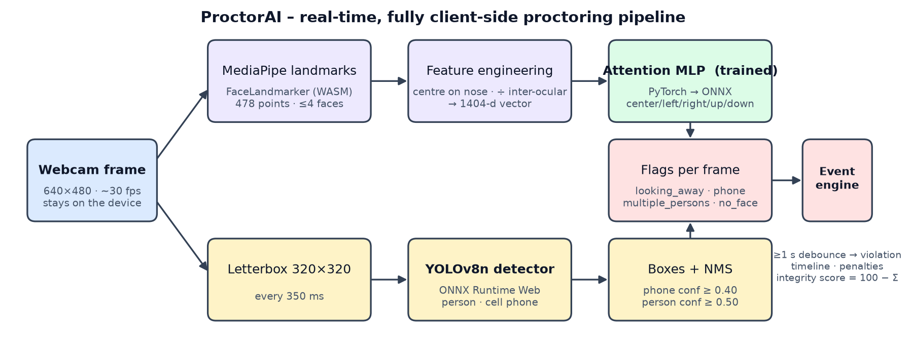
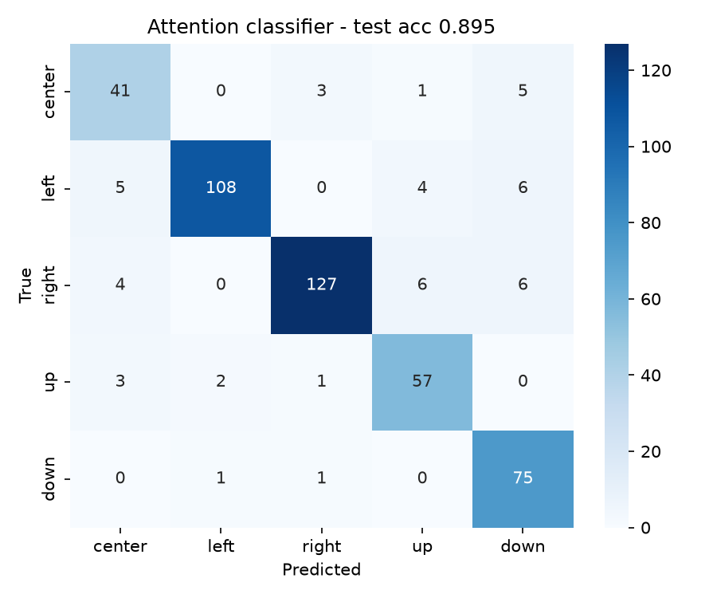
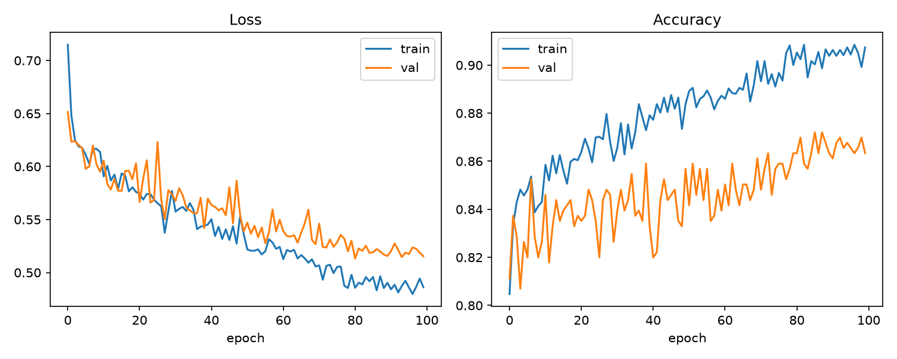

# Abstract

Online examinations and remote hiring assessments are now routine, yet they are usually taken without an invigilator in the room. ProctorAI is a browser-based proctoring system that detects the four most common cheating signals from a student's webcam in real time: looking away from the screen, a mobile phone in view, a second person in the frame, and the student leaving the camera. The system combines a MediaPipe face-landmark extractor with a purpose-built PyTorch attention classifier (trained in this project on 4,599 landmark samples derived from the Head-Pose Image Database) and a YOLOv8n object detector. Both deep models are exported to ONNX and executed entirely client-side with ONNX Runtime Web, so no video ever leaves the student's device. A temporal event engine converts frame-level predictions into debounced violations, a timestamped timeline and a single integrity score. The attention classifier reaches **{{ATTN_ACC}}** test accuracy (macro-F1 {{ATTN_F1}}); the complete pipeline runs at ~{{FPS}} fps on an integrated-graphics laptop. The application is deployed on Vercel with the source code, trained weights and this report published on GitHub.

# 1. Introduction

## 1.1 Problem statement

When exams moved online, the invigilator did not follow. A single teacher cannot watch forty webcam tiles at once, commercial proctoring services are expensive, and most of them stream the student's camera to a remote server, which raises privacy, bandwidth and legal concerns. At the same time, the cheating behaviours themselves are highly stereotyped: students look away at notes or a second screen, pick up a phone, let someone else sit beside them, or simply walk away.

The goal of this project is therefore to build a system that:

1. detects those four behaviours from a normal laptop webcam **in real time**;
2. is robust to short, innocent movements (a blink, a glance at the keyboard) by reasoning over time rather than over single frames;
3. runs **completely in the browser** so that it can be opened from a link, needs no installation, and keeps all video on the device;
4. produces an auditable output: a timeline of violations and an integrity score a teacher can act on.

## 1.2 Contributions

* A labelled landmark dataset for gaze-direction classification derived from the public Head-Pose Image Database, with a feature-engineering scheme that is invariant to face size, position and camera.
* A compact attention classifier (PyTorch MLP) trained and evaluated in this repository and exported to ONNX.
* A phone-detection fine-tuning experiment with YOLOv8n and an analysis of dataset domain shift.
* A complete, deployed web application (Vercel) that performs multi-model inference client-side and generates session reports.

# 2. Related work

Commercial systems such as ProctorU, Respondus Monitor and Proctorio rely on server-side video analysis combined with human review. Academic prototypes typically use OpenCV/dlib face landmarks with hand-crafted head-pose thresholds, or train a CNN end-to-end on cropped faces. ProctorAI follows the landmark route because landmarks are cheap to compute in the browser (MediaPipe FaceLandmarker ships as WebAssembly), but replaces hand-tuned thresholds with a learned classifier, which handles the non-linear interaction between pan and tilt angles and different face shapes. For object detection, the YOLO family remains the standard real-time choice; YOLOv8n was selected as the smallest model that still detects small objects such as a phone held near the face.

# 3. Datasets

## 3.1 Head-Pose Image Database

The Head-Pose Image Database (Gourier et al.) contains photographs of 15 people at 93 discrete head poses: pan ∈ {−90, −75, …, +90}° and tilt ∈ {−90, −60, −30, −15, 0, +15, +30, +60, +90}°. The Hugging Face mirror used here (`StevenLe456/head-pose`) stores 13,950 rows = 2,790 unique images × 5 colour-augmented copies. Because landmarks are insensitive to colour jitter, one copy per pose was downloaded (2,790 images, 384 × 288 px).

**Label mapping.** Angles were converted to five attention classes. If both |pan| ≤ 15° and |tilt| ≤ 15° the pose is `center` (looking at the screen). Otherwise the larger deviation decides: pan → `left`/`right`, tilt → `up`/`down`. The sign convention was verified visually on the images: tilt < 0 is looking down, and pan < 0 means the face is turned towards the image's right-hand side. Labels are therefore expressed from the camera's viewpoint, which is exactly what the webcam sees; the user interface mirrors them so the student sees their own left/right.

**Augmentation.** Every image was processed twice: as-is and horizontally flipped, with `left` ↔ `right` swapped. This doubles the data and forces the classifier to be symmetric. Images in which MediaPipe could not find a face (mostly full profiles at ±90°) were discarded. The final dataset contains **{{N_SAMPLES}}** landmark samples with the class distribution in Table 1.

Table 1 – Attention dataset class distribution.

| Class | Samples |
|---|---|
| center | {{N_CENTER}} |
| left | {{N_LEFT}} |
| right | {{N_RIGHT}} |
| up | {{N_UP}} |
| down | {{N_DOWN}} |

## 3.2 Phone-detection dataset

`harshdadiya-wappnet/phone_detection` is a Roboflow export (COCO JSON) with 529 training, 51 validation and 25 test images of mobile phones and tablets, mostly close-up photographs of devices lying on a surface. It was converted to YOLO format with `scripts/prepare_phone_dataset.py`.

# 4. Methodology

## 4.1 System architecture



Each webcam frame follows two parallel paths:

1. **Attention path.** MediaPipe FaceLandmarker returns 478 normalised 3-D landmarks for up to four faces. The first 468 points of the primary face are converted to a 1,414-dimensional feature vector (1,404 normalised coordinates + 10 explicit head-pose geometry cues) and classified by the attention MLP. Zero faces → *face missing*; more than one face → *multiple persons*.
2. **Object path.** Every 350 ms the frame is letter-boxed to 320 × 320 and passed through YOLOv8n. Boxes of class `cell phone` (confidence ≥ 0.40) raise the *phone* flag; more than one `person` box (≥ 0.50) also raises *multiple persons*.

A temporal **event engine** then debounces the flags: a flag must be continuously active for ≥ 1.0 s to open a violation, and continuously clear for ≥ 0.6 s to close it. Each closed event is penalised (phone 15 pts; multiple persons 10; face missing 5 + 0.5/s after 3 s; looking away 3 + 0.5/s after 3 s) and `score = max(0, 100 − Σ penalties)`.

## 4.2 Feature engineering

For landmarks $p_i = (x_i, y_i, z_i)$, $i = 1..468$:

$$\tilde{p}_i = \frac{p_i - p_{\text{nose}}}{\lVert (x,y)_{263} - (x,y)_{33} \rVert}$$

i.e. the face is centred on the nose tip and scaled by the inter-ocular distance (outer eye corners). Ten explicit geometry cues are appended – horizontal/vertical offset of the nose from the eye mid-point, cheek and eye depth asymmetry (yaw), chin-vs-forehead distance and depth (pitch), eye-line angle (roll) and the apparent face aspect ratio – giving a 1,414-d vector. The vector is standardised with the training-set mean and standard deviation, which are stored in `attention_norm.json` and applied identically in JavaScript (`web/js/features.js`).

## 4.3 Attention classifier

```
Linear(1414 → 512) · BatchNorm · ReLU · Dropout(0.3)
Linear(512  → 256) · BatchNorm · ReLU · Dropout(0.3)
Linear(256  → 5)
```

Training: AdamW (lr 2e-3, weight-decay 1e-4), cosine learning-rate schedule, 100 epochs, batch 64, cross-entropy with class weights and label smoothing 0.05, Gaussian jitter (σ = 0.02) on the standardised features as augmentation. The dataset was split **by source image** (80 / 10 / 10) so a flipped copy can never leak across splits; the checkpoint with the best validation accuracy was kept. Hidden sizes, dropout, learning rate and regularisation were selected with a small six-configuration grid search scored **on the validation split only** (`models/attention_grid.json`); four configurations tied on validation accuracy and the most strongly regularised one was chosen because it should transfer best from the lab dataset to live webcam video.

## 4.4 Object detector

The deployed detector is YOLOv8n pre-trained on COCO (80 classes), exported to ONNX at 320 px with static shapes. In addition, `scripts/train_phone_detector.py` fine-tunes the same backbone for a single `phone` class on the dataset of §3.2 (30 epochs, AdamW, mosaic/flip/HSV augmentation) to quantify how much a small domain-specific set helps.

## 4.5 Deployment

The web application is a static site (HTML, CSS, ES-module JavaScript) hosted on Vercel. Models are loaded from the same origin; MediaPipe and ONNX Runtime Web are loaded from a CDN. All inference uses WebAssembly, so the demo works on any modern laptop browser without a GPU. A session can be ended at any time to produce a report (counts, durations, penalties, timeline) that can be downloaded as JSON or printed to PDF.

# 5. Experiments and results

## 5.1 Attention classifier

Table 2 – Test-set results (n = {{N_TEST}}).

| Metric | Value |
|---|---|
| Accuracy | {{ATTN_ACC}} |
| Macro-F1 | {{ATTN_F1}} |
| Best validation accuracy | {{ATTN_VAL}} |

{{ATTN_REPORT_TABLE}}





{{ATTN_DISCUSSION}}

## 5.2 Phone detector

{{PHONE_RESULTS}}

## 5.3 Real-time performance

{{PERF}}

# 6. Discussion and limitations

* **Head pose ≠ gaze.** The classifier infers attention from head orientation; a student who moves only their eyes is not detected. Adding iris landmarks (MediaPipe provides 10) is a natural extension.
* **Camera placement.** The `center` class assumes the camera sits roughly at screen level. A laptop on a desk looking up at the student shifts the apparent tilt; a per-session calibration step would remove this.
* **Phone visibility.** Appearance-based detection cannot see a phone held below the desk.
* **Fairness and ethics.** Automated proctoring must not be the sole basis for an accusation. ProctorAI deliberately outputs a timeline for human review rather than a binary "cheated" verdict, and processes video locally to respect privacy.

# 7. Conclusion and future work

ProctorAI demonstrates that a complete multi-model proctoring pipeline can run in real time inside a browser tab. The purpose-trained attention classifier generalises from a 15-person lab dataset to live webcam video, and the temporal event engine turns noisy per-frame predictions into a stable, explainable report. Future work includes audio-based talking detection, a multi-student teacher dashboard with server-side session storage, iris-based gaze refinement, and a larger in-domain phone dataset recorded from webcams.

# References

1. Gourier, N., Hall, D., Crowley, J. L. *Estimating Face Orientation from Robust Detection of Salient Facial Features.* ICPR Workshop on Visual Observation of Deictic Gestures, 2004. (Head-Pose Image Database)
2. Lugaresi, C. et al. *MediaPipe: A Framework for Building Perception Pipelines.* arXiv:1906.08172, 2019.
3. Jocher, G., Chaurasia, A., Qiu, J. *Ultralytics YOLOv8.* https://github.com/ultralytics/ultralytics, 2023.
4. Lin, T.-Y. et al. *Microsoft COCO: Common Objects in Context.* ECCV 2014.
5. ONNX Runtime Web. https://onnxruntime.ai/docs/tutorials/web/
6. Paszke, A. et al. *PyTorch: An Imperative Style, High-Performance Deep Learning Library.* NeurIPS 2019.
7. Hugging Face datasets `StevenLe456/head-pose` and `harshdadiya-wappnet/phone_detection`.
